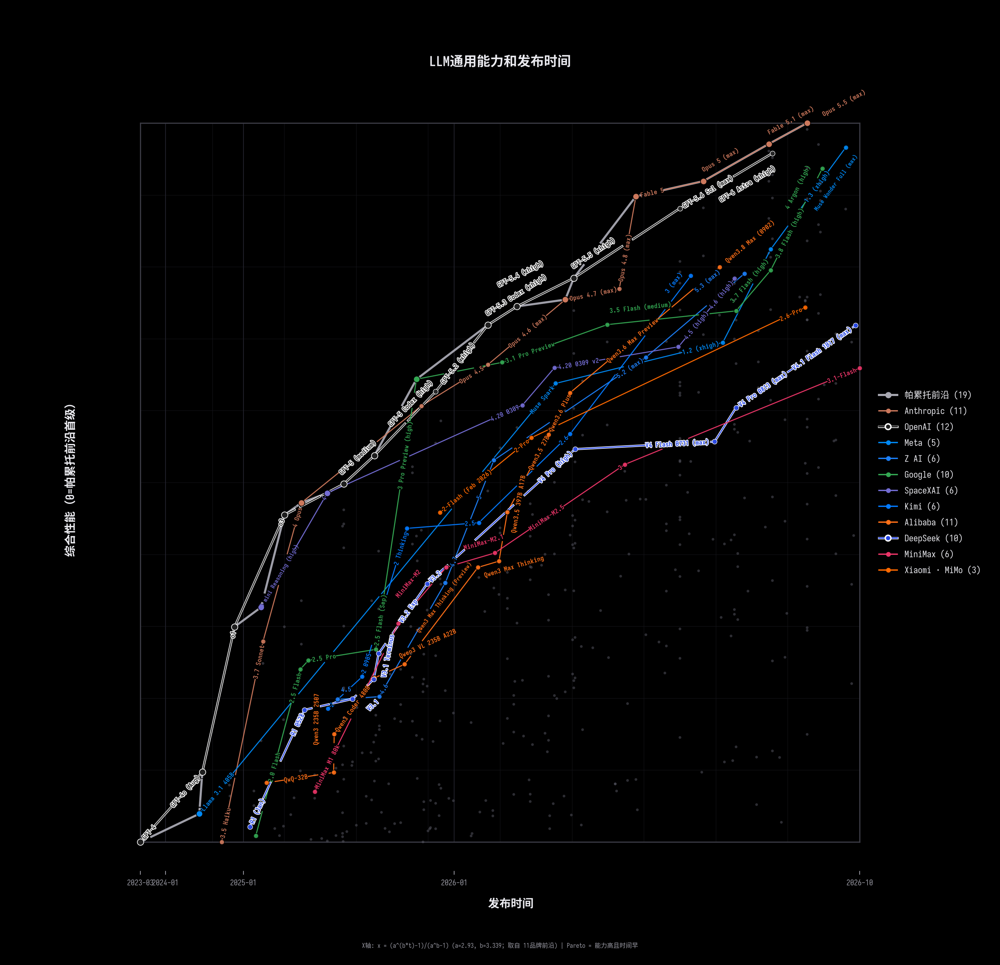

# LLM Leaderboard — 综合能力 vs 发布时间

## 全部模型（综合能力从高到低，最优 = 1，最差 = 0）

共收录 **Status: All**（含已弃用）的全部模型；按重新归一化后的综合能力排序。「帕累托」项：✅ = 总体帕累托前沿模型，❌ = 被支配。图表纵轴以总体帕累托前沿第一级（y0 = 0.2425，即前沿左端点 GPT-4）为 0：综合能力 ≥ 该级的 441 个模型入图，155 个能力低于第一级的不出现在图中；发布时间大于品牌前沿最大值的模型同样不入图（表列出全部模型）。

| # | 品牌 | 模型 | 综合能力 | 发布时间 | 横轴位置 | 帕累托 |
|---|------|------|---------|-----------|-----------|------|
| 1 |  Anthropic | Claude Opus 5.5 (max with fallback) | 1.0000 | 2026-09-22 | 0.9447 | ✅ |
| 2 |  Anthropic | Claude Opus 5.5 (xhigh with fallback) | 0.9933 | 2026-09-22 | 0.9447 | ❌ |
| 3 |  Anthropic | Claude Fable 5.1 (max with fallback) | 0.9780 | 2026-09-01 | 0.8898 | ✅ |
| 4 |  Anthropic | Claude Sonnet 5.5 (max with fallback) | 0.9773 | 2026-09-28 | 0.9610 | ❌ |
| 5 |  Meta | Muse Wonder Full (max) | 0.9742 | 2026-10-12 | 1.0000 | ❌ |
| 6 |  Anthropic | Claude Fable 5.1 (xhigh with fallback) | 0.9705 | 2026-09-01 | 0.8898 | ❌ |
| 7 |  OpenAI | GPT-6 Astra (xhigh) | 0.9681 | 2026-09-03 | 0.8949 | ❌ |
| 8 |  OpenAI | GPT-6 Astra (max) | 0.9634 | 2026-09-03 | 0.8949 | ❌ |
| 9 |  Anthropic | Claude Opus 5.5 (high with fallback) | 0.9524 | 2026-09-22 | 0.9447 | ❌ |
| 10 |  Google | Gemini 4 Argon (high) | 0.9523 | 2026-09-30 | 0.9665 | ❌ |
| 11 |  OpenAI | GPT-6 Astra (high) | 0.9454 | 2026-09-03 | 0.8949 | ❌ |
| 12 |  Anthropic | Claude Opus 5 (max) | 0.9388 | 2026-07-24 | 0.7960 | ✅ |
| 13 |  Anthropic | Claude Fable 5.1 (high with fallback) | 0.9386 | 2026-09-01 | 0.8898 | ❌ |
| 14 |  OpenAI | GPT-6.1 Sol (max) | 0.9364 | 2026-09-29 | 0.9637 | ❌ |
| 15 |  OpenAI | GPT-6.1 Sol (xhigh) | 0.9282 | 2026-09-29 | 0.9637 | ❌ |
| 16 |  Anthropic | Claude Opus 5 (xhigh) | 0.9242 | 2026-07-24 | 0.7960 | ❌ |
| 17 |  Anthropic | Claude Fable 5 (with fallback) | 0.9227 | 2026-06-09 | 0.6996 | ✅ |
| 18 |  OpenAI | GPT-6 Astra (medium) | 0.9210 | 2026-09-03 | 0.8949 | ❌ |
| 19 |  Anthropic | Claude Opus 5.5 (medium with fallback) | 0.9201 | 2026-09-22 | 0.9447 | ❌ |
| 20 |  OpenAI | GPT-6.1 Sol (high) | 0.9183 | 2026-09-29 | 0.9637 | ❌ |
| 21 |  Anthropic | Claude Opus 5 (high) | 0.9106 | 2026-07-24 | 0.7960 | ❌ |
| 22 |  OpenAI | GPT-5.6 Sol (max) | 0.9101 | 2026-07-09 | 0.7626 | ❌ |
| 23 |  Meta | Muse Wonder (max) | 0.9093 | 2026-10-12 | 1.0000 | ❌ |
| 24 |  Anthropic | Claude Fable 5.1 (medium with fallback) | 0.8995 | 2026-09-01 | 0.8898 | ❌ |
| 25 |  Anthropic | Claude Sonnet 5.5 (xhigh with fallback) | 0.8929 | 2026-09-28 | 0.9610 | ❌ |
| 26 |  OpenAI | GPT-6.1 Sol (medium) | 0.8851 | 2026-09-29 | 0.9637 | ❌ |
| 27 |  OpenAI | GPT-6 Astra (low) | 0.8780 | 2026-09-03 | 0.8949 | ❌ |
| 28 |  OpenAI | GPT-6 Sol (max) | 0.8758 | 2026-09-22 | 0.9447 | ❌ |
| 29 |  Meta | Muse Spark 1.3 (xhigh) | 0.8669 | 2026-09-02 | 0.8924 | ❌ |
| 30 |  Anthropic | Claude Fable 5.1 (low with fallback) | 0.8629 | 2026-09-01 | 0.8898 | ❌ |
| 31 |  Anthropic | Claude Opus 5 (medium) | 0.8600 | 2026-07-24 | 0.7960 | ❌ |
| 32 |  Meta | Muse Spark 1.3 (max) | 0.8586 | 2026-09-02 | 0.8924 | ❌ |
| 33 |  OpenAI | GPT-5.6 Sol (xhigh) | 0.8542 | 2026-07-09 | 0.7626 | ❌ |
| 34 |  Alibaba | Qwen3.8 Max (0902) | 0.8483 | 2026-09-02 | 0.8924 | ❌ |
| 35 |  Google | Gemini 3.8 Flash (high) | 0.8448 | 2026-09-02 | 0.8924 | ❌ |
| 36 |  OpenAI | GPT-5.6 Terra (max) | 0.8431 | 2026-07-09 | 0.7626 | ❌ |
| 37 |  Z AI | GLM-5.3 (max) | 0.8414 | 2026-08-18 | 0.8550 | ❌ |
| 38 |  Kimi | Kimi K3 (max) | 0.8390 | 2026-07-16 | 0.7780 | ❌ |
| 39 |  OpenAI | GPT-5.5 (xhigh) | 0.8367 | 2026-04-23 | 0.6110 | ✅ |
| 40 |  SpaceXAI | Grok 4.6 (high) | 0.8361 | 2026-08-12 | 0.8405 | ❌ |
| 41 |  OpenAI | GPT-5.6 Sol (high) | 0.8313 | 2026-07-09 | 0.7626 | ❌ |
| 42 |  SpaceXAI | Grok 4.6 (xhigh) | 0.8310 | 2026-08-12 | 0.8405 | ❌ |
| 43 |  Anthropic | Claude Opus 4.8 (max) | 0.8254 | 2026-05-28 | 0.6759 | ❌ |
| 44 |  OpenAI | GPT-6.1 Sol (low) | 0.8192 | 2026-09-29 | 0.9637 | ❌ |
| 45 |  StepFun | Step 5 Preview | 0.8166 | 2026-09-18 | 0.9340 | ❌ |
| 46 |  OpenAI | GPT-6 Sol (xhigh) | 0.8166 | 2026-09-22 | 0.9447 | ❌ |
| 47 |  Anthropic | Claude Opus 4.7 (max) | 0.8139 | 2026-04-16 | 0.5987 | ✅ |
| 48 |  SpaceXAI | Grok 4.6 (medium) | 0.8133 | 2026-08-12 | 0.8405 | ❌ |
| 49 |  SpaceXAI | Grok 4.7 (xhigh) | 0.8132 | 2026-09-21 | 0.9420 | ❌ |
| 50 |  SpaceXAI | Grok 4.7 (high) | 0.8123 | 2026-09-21 | 0.9420 | ❌ |
| 51 |  OpenAI | GPT-5.4 (xhigh) | 0.8068 | 2026-03-05 | 0.5301 | ✅ |
| 52 |  Xiaomi | MiMo-V2.6-Pro | 0.8057 | 2026-09-21 | 0.9420 | ❌ |
| 53 |  Google | Gemini 3.8 Flash (medium) | 0.8034 | 2026-09-02 | 0.8924 | ❌ |
| 54 |  OpenAI | GPT-5.6 Sol (medium) | 0.8031 | 2026-07-09 | 0.7626 | ❌ |
| 55 |  OpenAI | GPT-5.5 (high) | 0.8024 | 2026-04-23 | 0.6110 | ❌ |
| 56 |  Google | Gemini 3.7 Flash (high) | 0.8021 | 2026-08-13 | 0.8429 | ❌ |
| 57 |  Anthropic | Claude Sonnet 5.5 (high with fallback) | 0.7994 | 2026-09-28 | 0.9610 | ❌ |
| 58 |  Alibaba | Qwen3.8 Max | 0.7976 | 2026-08-03 | 0.8191 | ❌ |
| 59 |  OpenAI | GPT-6 Sol (high) | 0.7926 | 2026-09-22 | 0.9447 | ❌ |
| 60 |  Anthropic | Claude Opus 5.5 (low with fallback) | 0.7926 | 2026-09-22 | 0.9447 | ❌ |
| 61 |  Google | Gemini 3.7 Flash (medium) | 0.7924 | 2026-08-13 | 0.8429 | ❌ |
| 62 |  Google | Gemini 3.5 Flash (medium) | 0.7876 | 2026-05-19 | 0.6586 | ❌ |
| 63 |  OpenAI | GPT-5.3 Codex (xhigh) | 0.7872 | 2026-02-05 | 0.4885 | ✅ |
| 64 |  Z AI | GLM-5.3-Flash | 0.7812 | 2026-08-26 | 0.8747 | ❌ |
| 65 |  Anthropic | Claude Haiku 5.5 (max) | 0.7779 | 2026-10-07 | 0.9859 | ❌ |
| 66 |  Anthropic | Claude Opus 5 (low) | 0.7770 | 2026-07-24 | 0.7960 | ❌ |
| 67 |  Alibaba | Qwen3.8 2.4T A95B | 0.7724 | 2026-08-12 | 0.8405 | ❌ |
| 68 |  Anthropic | Claude Sonnet 5 (max) | 0.7699 | 2026-06-30 | 0.7431 | ❌ |
| 69 |  Google | Gemini 3.5 Flash (high) | 0.7693 | 2026-05-19 | 0.6586 | ❌ |
| 70 |  Meta | Muse Spark 1.2 (xhigh) | 0.7688 | 2026-08-05 | 0.8238 | ❌ |
| 71 |  SpaceXAI | Grok 4.5 (high) | 0.7642 | 2026-07-08 | 0.7604 | ❌ |
| 72 |  OpenAI | GPT-6 Sol (medium) | 0.7597 | 2026-09-22 | 0.9447 | ❌ |
| 73 |  OpenAI | GPT-5.6 Terra (xhigh) | 0.7581 | 2026-07-09 | 0.7626 | ❌ |
| 74 |  OpenAI | GPT-5.5 (medium) | 0.7572 | 2026-04-23 | 0.6110 | ❌ |
| 75 |  Z AI | GLM-5.2 (max) | 0.7532 | 2026-06-16 | 0.7139 | ❌ |
| 76 |  SpaceXAI | Grok 4.7 (low) | 0.7504 | 2026-09-21 | 0.9420 | ❌ |
| 77 |  Alibaba | Qwen3.8-Flash-Next | 0.7483 | 2026-08-26 | 0.8747 | ❌ |
| 78 |  Google | Gemini 3.1 Pro Preview | 0.7478 | 2026-02-19 | 0.5089 | ❌ |
| 79 |  Google | Gemini 3.7 Flash (low) | 0.7465 | 2026-08-13 | 0.8429 | ❌ |
| 80 |  Anthropic | Claude Opus 4.6 (max) | 0.7454 | 2026-02-05 | 0.4885 | ❌ |
| 81 |  SpaceXAI | Grok 4.20 0309 v2 | 0.7421 | 2026-04-07 | 0.5833 | ❌ |
| 82 |  Google | Gemini 3 Pro Preview (high) | 0.7300 | 2025-11-18 | 0.3872 | ✅ |
| 83 |  SpaceXAI | Grok 4.3 (medium) | 0.7283 | 2026-04-30 | 0.6235 | ❌ |
| 84 |  OpenAI | GPT-5.6 Sol (low) | 0.7269 | 2026-07-09 | 0.7626 | ❌ |
| 85 |  Meta | Muse Spark | 0.7257 | 2026-04-08 | 0.5850 | ❌ |
| 86 |  Anthropic | Claude Haiku 5.5 (xhigh) | 0.7256 | 2026-10-07 | 0.9859 | ❌ |
| 87 |  InclusionAI | Ling 3.1 Flash | 0.7242 | 2026-10-01 | 0.9692 | ❌ |
| 88 |  Meta | Muse Spark 1.1 (xhigh) | 0.7231 | 2026-07-09 | 0.7626 | ❌ |
| 89 |  Sapiens AI | Agnes 2.5 Pro Beta | 0.7211 | 2026-08-26 | 0.8747 | ❌ |
| 90 |  OpenAI | GPT-5.2 (xhigh) | 0.7170 | 2025-12-11 | 0.4144 | ❌ |
| 91 |  OpenAI | GPT-5.2 Codex (xhigh) | 0.7167 | 2025-12-11 | 0.4144 | ❌ |
| 92 |  Google | Gemini 3.6 Flash (high) | 0.7163 | 2026-07-21 | 0.7892 | ❌ |
| 93 |  Alibaba | Qwen3.6 Max Preview | 0.7158 | 2026-04-20 | 0.6057 | ❌ |
| 94 |  OpenAI | GPT-5.6 Luna (max) | 0.7156 | 2026-07-09 | 0.7626 | ❌ |
| 95 |  OpenAI | GPT-5.6 Terra (high) | 0.7130 | 2026-07-09 | 0.7626 | ❌ |
| 96 |  Anthropic | Claude Sonnet 5.5 (medium with fallback) | 0.7091 | 2026-09-28 | 0.9610 | ❌ |
| 97 |  Google | Gemini 3.8 Flash (low) | 0.7080 | 2026-09-02 | 0.8924 | ❌ |
| 98 |  SpaceXAI | Grok 4.20 0309 | 0.7027 | 2026-03-10 | 0.5378 | ❌ |
| 99 |  Anthropic | Claude Opus 4.5 | 0.7020 | 2025-11-24 | 0.3941 | ❌ |
| 100 |  DeepSeek | DeepSeek V4 Pro 0813 (max) | 0.7002 | 2026-08-13 | 0.8429 | ❌ |
| 101 |  OpenAI | GPT-5.5 (low) | 0.6992 | 2026-04-23 | 0.6110 | ❌ |
| 102 |  Anthropic | Claude Opus 4.7 (non-reasoning, high) | 0.6969 | 2026-04-16 | 0.5987 | ❌ |
| 103 |  OpenAI | GPT-6 Luna (max) | 0.6881 | 2026-09-22 | 0.9447 | ❌ |
| 104 |  DeepSeek | DeepSeek V4.1 Flash (max) | 0.6874 | 2026-09-10 | 0.9130 | ❌ |
| 105 |  Google | Gemini 3 Flash | 0.6862 | 2025-12-17 | 0.4218 | ❌ |
| 106 |  SpaceXAI | Grok 4.6 (low) | 0.6825 | 2026-08-12 | 0.8405 | ❌ |
| 107 |  Alibaba | Qwen3.7 Max | 0.6819 | 2026-05-19 | 0.6586 | ❌ |
| 108 |  OpenAI | GPT-6 Sol (low) | 0.6795 | 2026-09-22 | 0.9447 | ❌ |
| 109 |  OpenAI | GPT-5.4 (low) | 0.6791 | 2026-03-05 | 0.5301 | ❌ |
| 110 |  Motif Technologies | Motif 3 | 0.6774 | 2026-08-12 | 0.8405 | ❌ |
| 111 |  Alibaba | Qwen3.8 27B (xhigh) | 0.6743 | 2026-08-14 | 0.8453 | ❌ |
| 112 |  Kimi | Kimi K2.6 | 0.6724 | 2026-04-20 | 0.6057 | ❌ |
| 113 |  Alibaba | Qwen3.6 Plus | 0.6719 | 2026-04-02 | 0.5750 | ❌ |
| 114 |  SpaceXAI | Grok 4.3 (low) | 0.6712 | 2026-04-30 | 0.6235 | ❌ |
| 115 |  Xiaomi | MiMo-V2-Pro | 0.6684 | 2026-03-18 | 0.5505 | ❌ |
| 116 |  OpenAI | GPT-5.6 Luna (xhigh) | 0.6677 | 2026-07-09 | 0.7626 | ❌ |
| 117 |  Anthropic | Claude Haiku 5.5 (high) | 0.6660 | 2026-10-07 | 0.9859 | ❌ |
| 118 |  Mistral | Mistral Large 4 Preview | 0.6650 | 2026-10-06 | 0.9831 | ❌ |
| 119 |  DeepSeek | DeepSeek V4 Flash Vision (max) | 0.6649 | 2026-08-21 | 0.8623 | ❌ |
| 120 |  DeepSeek | DeepSeek V4 Flash 0731 (max) | 0.6643 | 2026-07-31 | 0.8121 | ❌ |
| 121 |  OpenAI | GPT-5.2 (medium) | 0.6627 | 2025-12-11 | 0.4144 | ❌ |
| 122 |  Anthropic | Claude Sonnet 4.6 (max) | 0.6578 | 2026-02-17 | 0.5059 | ❌ |
| 123 |  DeepSeek | DeepSeek V4 Pro (high) | 0.6564 | 2026-04-24 | 0.6128 | ❌ |
| 124 |  OpenAI | GPT-5 Codex (high) | 0.6496 | 2025-09-23 | 0.3277 | ✅ |
| 125 |  Z AI | GLM-5 | 0.6448 | 2026-02-11 | 0.4971 | ❌ |
| 126 |  OpenAI | GPT-5.6 Terra (medium) | 0.6444 | 2026-07-09 | 0.7626 | ❌ |
| 127 |  Kimi | Kimi K3 (low) | 0.6434 | 2026-07-16 | 0.7780 | ❌ |
| 128 |  China Mobile | JT-4.1 Flash 236B A21B | 0.6432 | 2026-07-09 | 0.7626 | ❌ |
| 129 |  DeepSeek | DeepSeek V4 Pro (max) | 0.6430 | 2026-04-24 | 0.6128 | ❌ |
| 130 |  Xiaomi | MiMo-V2.6-Flash | 0.6415 | 2026-09-21 | 0.9420 | ❌ |
| 131 |  MiniMax | MiniMax-M3 | 0.6403 | 2026-06-01 | 0.6837 | ❌ |
| 132 |  OpenAI | GPT-5.1 (high) | 0.6379 | 2025-11-13 | 0.3815 | ❌ |
| 133 |  Anthropic | Claude Sonnet 5.5 (low with fallback) | 0.6371 | 2026-09-28 | 0.9610 | ❌ |
| 134 |  Alibaba | Qwen3.7 Plus | 0.6331 | 2026-06-01 | 0.6837 | ❌ |
| 135 |  OpenAI | GPT-5.1 Codex (high) | 0.6315 | 2025-11-13 | 0.3815 | ❌ |
| 136 |  OpenAI | GPT-6 Luna (xhigh) | 0.6308 | 2026-09-22 | 0.9447 | ❌ |
| 137 |  OpenAI | GPT-5.6 Luna (high) | 0.6290 | 2026-07-09 | 0.7626 | ❌ |
| 138 |  Xiaomi | MiMo-V2-Omni-0327 | 0.6219 | 2026-03-27 | 0.5650 | ❌ |
| 139 |  Z AI | GLM-5.1 | 0.6215 | 2026-04-07 | 0.5833 | ❌ |
| 140 |  OpenAI | GPT-5 (medium) | 0.6198 | 2025-08-07 | 0.2844 | ✅ |
| 141 |  Anthropic | Claude Sonnet 5 (xhigh) | 0.6185 | 2026-06-30 | 0.7431 | ❌ |
| 142 |  Anthropic | Claude Opus 4.6 (non-reasoning, high) | 0.6123 | 2026-02-05 | 0.4885 | ❌ |
| 143 |  Z AI | GLM-5-Turbo | 0.6121 | 2026-03-15 | 0.5457 | ❌ |
| 144 |  Motif Technologies | Motif 3 (Beta) | 0.6109 | 2026-07-14 | 0.7736 | ❌ |
| 145 |  SpaceXAI | Grok 4 | 0.6102 | 2025-07-10 | 0.2611 | ✅ |
| 146 |  Anthropic | Claude Haiku 5.5 (medium) | 0.6075 | 2026-10-07 | 0.9859 | ❌ |
| 147 |  Institute of Foundation Models | K2 Horizon 375B A23B | 0.6062 | 2026-09-03 | 0.8949 | ❌ |
| 148 |  Z AI | GLM-5.3 (low) | 0.6050 | 2026-08-18 | 0.8550 | ❌ |
| 149 |  Kimi | Kimi K2.7 Code | 0.6038 | 2026-06-12 | 0.7057 | ❌ |
| 150 |  SpaceXAI | Grok Build 0.1 0616 | 0.6035 | 2026-06-16 | 0.7139 | ❌ |
| 151 |  SpaceXAI | Grok 4.3 (high) | 0.6031 | 2026-04-30 | 0.6235 | ❌ |
| 152 |  Nex AGI | Nex-N2-Pro | 0.6025 | 2026-06-02 | 0.6857 | ❌ |
| 153 |  OpenAI | GPT-5.5 Instant (May 2026) | 0.6013 | 2026-05-05 | 0.6325 | ❌ |
| 154 |  Anthropic | Claude 4 Opus | 0.5998 | 2025-05-22 | 0.2245 | ✅ |
| 155 |  OpenAI | GPT-5.4 mini (xhigh) | 0.5989 | 2026-03-17 | 0.5489 | ❌ |
| 156 |  OpenAI | GPT-6 Luna (high) | 0.5985 | 2026-09-22 | 0.9447 | ❌ |
| 157 |  OpenAI | GPT-5 (high) | 0.5924 | 2025-08-07 | 0.2844 | ❌ |
| 158 |  Google | Gemini 3.5 Flash (minimal) | 0.5903 | 2026-05-19 | 0.6586 | ❌ |
| 159 |  Alibaba | Qwen3.5 27B | 0.5901 | 2026-02-24 | 0.5163 | ❌ |
| 160 |  Xiaomi | MiMo-V2-Flash (Feb 2026) | 0.5897 | 2025-12-16 | 0.4206 | ❌ |
| 161 |  Xiaomi | MiMo-V2-Omni | 0.5876 | 2026-03-19 | 0.5521 | ❌ |
| 162 |  OpenAI | o3 | 0.5870 | 2025-04-16 | 0.2006 | ✅ |
| 163 |  Xiaomi | MiMo-V2.5-Pro | 0.5864 | 2026-04-22 | 0.6092 | ❌ |
| 164 |  OpenAI | GPT-5.6 Terra (low) | 0.5848 | 2026-07-09 | 0.7626 | ❌ |
| 165 |  Z AI | GLM 5V Turbo | 0.5833 | 2026-04-01 | 0.5733 | ❌ |
| 166 |  OpenAI | GPT-5.6 Sol (non-reasoning) | 0.5819 | 2026-07-09 | 0.7626 | ❌ |
| 167 |  DeepSeek | DeepSeek V4 Flash (max) | 0.5816 | 2026-04-24 | 0.6128 | ❌ |
| 168 |  InclusionAI | Ling-3.0-flash-VL | 0.5805 | 2026-09-10 | 0.9130 | ❌ |
| 169 |  Kimi | Kimi K2.5 | 0.5789 | 2026-01-27 | 0.4758 | ❌ |
| 170 |  Anthropic | Claude Sonnet 5 (high) | 0.5777 | 2026-06-30 | 0.7431 | ❌ |
| 171 |  OpenAI | GPT-5 mini (medium) | 0.5776 | 2025-08-07 | 0.2844 | ❌ |
| 172 |  Xiaomi | MiMo-V2.5 | 0.5755 | 2026-04-22 | 0.6092 | ❌ |
| 173 |  Anthropic | Claude 4.1 Opus | 0.5752 | 2025-08-05 | 0.2827 | ❌ |
| 174 |  Apodex | Apodex 1.1 | 0.5743 | 2026-08-30 | 0.8848 | ❌ |
| 175 |  Anthropic | Claude Sonnet 4.6 (non-reasoning, high) | 0.5735 | 2026-02-17 | 0.5059 | ❌ |
| 176 |  Kimi | Kimi K2 Thinking | 0.5729 | 2025-11-06 | 0.3737 | ❌ |
| 177 |  Anthropic | Claude Opus 4.5 (non-reasoning) | 0.5710 | 2025-11-24 | 0.3941 | ❌ |
| 178 |  Anthropic | Claude Sonnet 5 (non-reasoning) | 0.5705 | 2026-06-30 | 0.7431 | ❌ |
| 179 |  Anthropic | Claude Sonnet 4.6 (non-reasoning, low) | 0.5681 | 2026-02-17 | 0.5059 | ❌ |
| 180 |  Thinking Machines | Inkling (xhigh) | 0.5672 | 2026-07-15 | 0.7758 | ❌ |
| 181 |  Upstage | Solar Open2 250B | 0.5661 | 2026-08-12 | 0.8405 | ❌ |
| 182 |  Kimi | Kimi K2.6 (non-reasoning) | 0.5659 | 2026-04-20 | 0.6057 | ❌ |
| 183 |  Google | Gemini 3 Pro Preview (low) | 0.5648 | 2025-11-18 | 0.3872 | ❌ |
| 184 |  OpenAI | GPT-5.4 nano (xhigh) | 0.5647 | 2026-03-17 | 0.5489 | ❌ |
| 185 |  OpenAI | GPT-6 Luna (medium) | 0.5616 | 2026-09-22 | 0.9447 | ❌ |
| 186 |  Thinking Machines | Inkling Small | 0.5615 | 2026-07-30 | 0.8098 | ❌ |
| 187 |  Multiverse Computing | Quasar 438B (max) | 0.5607 | 2026-08-10 | 0.8357 | ❌ |
| 188 |  DeepSeek | DeepSeek V4 Flash (high) | 0.5572 | 2026-04-24 | 0.6128 | ❌ |
| 189 |  OpenAI | GPT-5.1 Codex mini (high) | 0.5564 | 2025-11-13 | 0.3815 | ❌ |
| 190 |  China Mobile | JT-4.1 Flash 236B A21B (non-reasoning) | 0.5558 | 2026-07-09 | 0.7626 | ❌ |
| 191 |  Alibaba | Qwen3.6 27B | 0.5557 | 2026-04-22 | 0.6092 | ❌ |
| 192 |  Upstage | Solar Pro 4 | 0.5531 | 2026-08-06 | 0.8262 | ❌ |
| 193 |  OpenAI | GPT-5 (low) | 0.5524 | 2025-08-07 | 0.2844 | ❌ |
| 194 |  Tencent | Hy3-preview | 0.5522 | 2026-04-23 | 0.6110 | ❌ |
| 195 |  Anthropic | Claude 4.5 Sonnet | 0.5489 | 2025-09-29 | 0.3336 | ❌ |
| 196 |  MiniMax | MiniMax-M2.5 | 0.5471 | 2026-02-12 | 0.4986 | ❌ |
| 197 |  Alibaba | Qwen3.8 27B (medium) | 0.5465 | 2026-08-14 | 0.8453 | ❌ |
| 198 |  Anthropic | Claude Haiku 5.5 (low) | 0.5462 | 2026-10-07 | 0.9859 | ❌ |
| 199 |  NVIDIA | Nemotron 3 Ultra | 0.5460 | 2026-06-04 | 0.6897 | ❌ |
| 200 |  Z AI | GLM-5.1 (non-reasoning) | 0.5460 | 2026-04-07 | 0.5833 | ❌ |
| 201 |  Alibaba | Qwen3.5 Omni Plus | 0.5456 | 2026-03-30 | 0.5700 | ❌ |
| 202 |  SpaceXAI | Grok 4.1 Fast | 0.5387 | 2025-11-19 | 0.3884 | ❌ |
| 203 |  Alibaba | Qwen3.5 397B A17B | 0.5384 | 2026-02-16 | 0.5044 | ❌ |
| 204 |  KwaiKAT | KAT-Coder-Pro V2 | 0.5341 | 2026-03-27 | 0.5650 | ❌ |
| 205 |  OpenAI | GPT-5.4 nano (medium) | 0.5326 | 2026-03-17 | 0.5489 | ❌ |
| 206 |  Alibaba | Qwen3.8 27B (low) | 0.5326 | 2026-08-14 | 0.8453 | ❌ |
| 207 |  MiniMax | MiniMax-M2.1 | 0.5320 | 2025-12-23 | 0.4294 | ❌ |
| 208 |  MiniMax | MiniMax-M2.7 | 0.5318 | 2026-03-18 | 0.5505 | ❌ |
| 209 |  Alibaba | Qwen3 Max Thinking | 0.5318 | 2026-01-26 | 0.4744 | ❌ |
| 210 |  Tencent | Hy3 | 0.5293 | 2026-07-06 | 0.7560 | ❌ |
| 211 |  Google | Gemini 3.5 Flash-Lite | 0.5282 | 2026-07-21 | 0.7892 | ❌ |
| 212 |  Alibaba | Qwen3.5 35B A3B | 0.5266 | 2026-02-24 | 0.5163 | ❌ |
| 213 |  StepFun | Step 3.7 Flash | 0.5226 | 2026-05-29 | 0.6778 | ❌ |
| 214 |  OpenAI | GPT-5.6 Luna (medium) | 0.5222 | 2026-07-09 | 0.7626 | ❌ |
| 215 |  Kimi | Kimi K2.5 (non-reasoning) | 0.5212 | 2026-01-27 | 0.4758 | ❌ |
| 216 |  Xiaomi | MiMo-V2-Flash | 0.5198 | 2025-12-16 | 0.4206 | ❌ |
| 217 |  OpenAI | GPT-5.4 mini (medium) | 0.5188 | 2026-03-17 | 0.5489 | ❌ |
| 218 |  Institute of Foundation Models | K2 Horizon MoVA 36B A4B | 0.5180 | 2026-09-03 | 0.8949 | ❌ |
| 219 |  Z AI | GLM-4.7 | 0.5154 | 2025-12-22 | 0.4281 | ❌ |
| 220 |  DeepSeek | DeepSeek V3.2 | 0.5146 | 2025-12-01 | 0.4024 | ❌ |
| 221 |  Google | Gemini 3 Flash (non-reasoning) | 0.5142 | 2025-12-17 | 0.4218 | ❌ |
| 222 |  OpenAI | GPT-6 Sol (non-reasoning) | 0.5119 | 2026-09-22 | 0.9447 | ❌ |
| 223 |  Z AI | GLM-5 (non-reasoning) | 0.5101 | 2026-02-11 | 0.4971 | ❌ |
| 224 |  Alibaba | Qwen3.6 35B A3B | 0.5081 | 2026-04-16 | 0.5987 | ❌ |
| 225 |  OpenAI | GPT-5.5 (non-reasoning) | 0.5071 | 2026-04-23 | 0.6110 | ❌ |
| 226 |  Anthropic | Claude Sonnet 5 (medium) | 0.5068 | 2026-06-30 | 0.7431 | ❌ |
| 227 |  AI9Stars | G9v3-39A5B | 0.5068 | 2026-08-20 | 0.8599 | ❌ |
| 228 |  Alibaba | Qwen3.5 397B A17B (non-reasoning) | 0.5033 | 2026-02-16 | 0.5044 | ❌ |
| 229 |  StepFun | Step 3.5 Flash 2603 | 0.5031 | 2026-04-02 | 0.5750 | ❌ |
| 230 |  Alibaba | Qwen3.5 122B A10B | 0.4993 | 2026-02-24 | 0.5163 | ❌ |
| 231 |  Anthropic | Claude 4 Sonnet | 0.4967 | 2025-05-22 | 0.2245 | ❌ |
| 232 |  SpaceXAI | Grok 4 Fast | 0.4967 | 2025-09-19 | 0.3238 | ❌ |
| 233 |  SpaceXAI | Grok 3 mini Reasoning (high) | 0.4899 | 2025-02-19 | 0.1679 | ✅ |
| 234 |  Alibaba | Qwen3.5 27B (non-reasoning) | 0.4885 | 2026-02-24 | 0.5163 | ❌ |
| 235 |  Anthropic | Claude 4.5 Sonnet (non-reasoning) | 0.4882 | 2025-09-29 | 0.3336 | ❌ |
| 236 |  SK Telecom | A.X-K2 | 0.4874 | 2026-08-12 | 0.8405 | ❌ |
| 237 |  DeepSeek | DeepSeek V3.2 Speciale | 0.4869 | 2025-12-01 | 0.4024 | ❌ |
| 238 |  China Mobile | JT-35B-Flash | 0.4863 | 2026-05-14 | 0.6492 | ❌ |
| 239 |  StepFun | Step 3.5 Flash | 0.4854 | 2026-02-02 | 0.4842 | ❌ |
| 240 |  InclusionAI | Ling-3.0-flash-Fin | 0.4834 | 2026-09-11 | 0.9156 | ❌ |
| 241 |  LG AI Research | K-EXAONE 2.0 | 0.4825 | 2026-08-12 | 0.8405 | ❌ |
| 242 |  InclusionAI | Ling 3.0 Flash | 0.4791 | 2026-08-04 | 0.8215 | ❌ |
| 243 |  Alibaba | Qwen3.8 27B (non-reasoning) | 0.4769 | 2026-08-14 | 0.8453 | ❌ |
| 244 |  Google | Gemma 4 31B | 0.4762 | 2026-04-02 | 0.5750 | ❌ |
| 245 |  OpenAI | GPT-5.4 (non-reasoning) | 0.4732 | 2026-03-05 | 0.5301 | ❌ |
| 246 |  MiniMax | MiniMax-M2 | 0.4728 | 2025-10-26 | 0.3616 | ❌ |
| 247 |  OpenAI | GPT-5 mini (high) | 0.4699 | 2025-08-07 | 0.2844 | ❌ |
| 248 |  ByteDance Seed | Doubao Seed Code | 0.4695 | 2025-11-11 | 0.3792 | ❌ |
| 249 |  OpenAI | o1 | 0.4693 | 2024-12-05 | 0.1308 | ✅ |
| 250 |  OpenAI | o4-mini (high) | 0.4693 | 2025-04-16 | 0.2006 | ❌ |
| 251 |  Upstage | Solar Mini 4 | 0.4683 | 2026-09-22 | 0.9447 | ❌ |
| 252 |  OpenAI | GPT-5.6 Luna (low) | 0.4670 | 2026-07-09 | 0.7626 | ❌ |
| 253 |  OpenAI | GPT-6 Luna (low) | 0.4655 | 2026-09-22 | 0.9447 | ❌ |
| 254 |  Z AI | GLM-5.2 (non-reasoning) | 0.4609 | 2026-06-16 | 0.7139 | ❌ |
| 255 |  Meta | Muse Glimmer (high) | 0.4596 | 2026-08-10 | 0.8357 | ❌ |
| 256 |  DeepSeek | DeepSeek V4 Pro (non-reasoning) | 0.4580 | 2026-04-24 | 0.6128 | ❌ |
| 257 |  Alibaba | Qwen3.6 27B (non-reasoning) | 0.4556 | 2026-04-22 | 0.6092 | ❌ |
| 258 |  Anthropic | Claude 3.7 Sonnet | 0.4539 | 2025-02-24 | 0.1706 | ❌ |
| 259 |  OpenAI | GPT-5.5 Instant (June 2026) | 0.4532 | 2026-06-25 | 0.7325 | ❌ |
| 260 |  Anthropic | Claude 4 Sonnet (non-reasoning) | 0.4510 | 2025-05-22 | 0.2245 | ❌ |
| 261 |  Anthropic | Claude Sonnet 5 (low) | 0.4490 | 2026-06-30 | 0.7431 | ❌ |
| 262 |  Mistral | Mistral Medium 3.5 | 0.4485 | 2026-04-29 | 0.6217 | ❌ |
| 263 |  InclusionAI | Ring-2.6-1T | 0.4471 | 2026-05-08 | 0.6380 | ❌ |
| 264 |  Google | Gemini 2.5 Flash (Sep) | 0.4454 | 2025-09-25 | 0.3297 | ❌ |
| 265 |  DeepSeek | DeepSeek V3.2 Exp | 0.4410 | 2025-09-29 | 0.3336 | ❌ |
| 266 |  KwaiKAT | KAT-Coder-Pro V1 | 0.4410 | 2025-11-11 | 0.3792 | ❌ |
| 267 |  Amazon | Nova 2.0 Pro Preview (medium) | 0.4404 | 2025-11-27 | 0.3977 | ❌ |
| 268 |  OpenAI | GPT-5.2 (non-reasoning) | 0.4388 | 2025-12-11 | 0.4144 | ❌ |
| 269 |  Anthropic | Claude 4.5 Haiku | 0.4374 | 2025-10-15 | 0.3500 | ❌ |
| 270 |  DeepSeek | DeepSeek V4.1 Flash (non-reasoning) | 0.4371 | 2026-09-10 | 0.9130 | ❌ |
| 271 |  Cohere | Command A+ | 0.4368 | 2026-05-20 | 0.6605 | ❌ |
| 272 |  OpenAI | GPT-5.6 Terra (non-reasoning) | 0.4360 | 2026-07-09 | 0.7626 | ❌ |
| 273 |  Alibaba | Qwen3.5 122B A10B (non-reasoning) | 0.4356 | 2026-02-24 | 0.5163 | ❌ |
| 274 |  Google | Gemini 2.5 Pro | 0.4339 | 2025-06-05 | 0.2345 | ❌ |
| 275 |  Institute of Foundation Models | K2 Horizon 7B | 0.4333 | 2026-09-03 | 0.8949 | ❌ |
| 276 |  Anthropic | Claude 3.7 Sonnet (non-reasoning) | 0.4307 | 2025-02-24 | 0.1706 | ❌ |
| 277 |  Alibaba | Qwen3 Max Thinking (Preview) | 0.4298 | 2025-11-03 | 0.3703 | ❌ |
| 278 |  Google | Gemini 2.5 Flash | 0.4246 | 2025-05-20 | 0.2231 | ❌ |
| 279 |  Amazon | Nova 2.0 Lite (medium) | 0.4245 | 2025-10-29 | 0.3649 | ❌ |
| 280 |  LongCat | LongCat 2.0 | 0.4206 | 2026-06-29 | 0.7410 | ❌ |
| 281 |  Xiaomi | MiMo-V2.5-Pro (non-reasoning) | 0.4195 | 2026-04-22 | 0.6092 | ❌ |
| 282 |  Anthropic | Claude 4.5 Haiku (non-reasoning) | 0.4194 | 2025-10-15 | 0.3500 | ❌ |
| 283 |  Google | Gemma 4 26B A4B | 0.4171 | 2026-04-02 | 0.5750 | ❌ |
| 284 |  Kimi | Kimi K2 0905 | 0.4167 | 2025-09-05 | 0.3104 | ❌ |
| 285 |  Baidu | ERNIE 5.0 Thinking Preview | 0.4160 | 2025-11-13 | 0.3815 | ❌ |
| 286 |  DeepSeek | DeepSeek V4 Flash (non-reasoning) | 0.4154 | 2026-04-24 | 0.6128 | ❌ |
| 287 |  Alibaba | Qwen3 VL 235B A22B | 0.4153 | 2025-09-23 | 0.3277 | ❌ |
| 288 |  Amazon | Nova 2.0 Pro Preview (low) | 0.4141 | 2025-11-27 | 0.3977 | ❌ |
| 289 |  DeepSeek | DeepSeek V3.1 Terminus | 0.4138 | 2025-09-22 | 0.3267 | ❌ |
| 290 |  SpaceXAI | Grok 4.20 0309 (non-reasoning) | 0.4129 | 2026-03-10 | 0.5378 | ❌ |
| 291 |  InclusionAI | Ling-2.6-1T | 0.4125 | 2026-04-23 | 0.6110 | ❌ |
| 292 |  Google | Gemini 3.1 Flash-Lite | 0.4117 | 2026-03-03 | 0.5270 | ❌ |
| 293 |  Amazon | Nova 2.0 Omni (low) | 0.4090 | 2025-11-26 | 0.3965 | ❌ |
| 294 |  DeepSeek | DeepSeek V3.2 (non-reasoning) | 0.4067 | 2025-12-01 | 0.4024 | ❌ |
| 295 |  Tencent | Hy3-preview (non-reasoning) | 0.4049 | 2026-04-23 | 0.6110 | ❌ |
| 296 |  OpenAI | GPT-5 nano (high) | 0.4049 | 2025-08-07 | 0.2844 | ❌ |
| 297 |  OpenAI | GPT-5 nano (medium) | 0.4028 | 2025-08-07 | 0.2844 | ❌ |
| 298 |  Z AI | GLM-4.7 (non-reasoning) | 0.4020 | 2025-12-22 | 0.4281 | ❌ |
| 299 |  Amazon | Nova 2.0 Omni (medium) | 0.4008 | 2025-11-26 | 0.3965 | ❌ |
| 300 |  Alibaba | Qwen3.6 35B A3B (non-reasoning) | 0.4007 | 2026-04-16 | 0.5987 | ❌ |
| 301 |  Alibaba | Qwen3.5 4B | 0.3970 | 2026-03-02 | 0.5254 | ❌ |
| 302 |  SpaceXAI | Grok 4.20 0309 v2 (non-reasoning) | 0.3968 | 2026-04-07 | 0.5833 | ❌ |
| 303 |  Z AI | GLM-4.6 | 0.3956 | 2025-09-30 | 0.3346 | ❌ |
| 304 |  LG AI Research | EXAONE 4.5 33B | 0.3937 | 2026-04-09 | 0.5867 | ❌ |
| 305 |  DeepSeek | DeepSeek V3.1 | 0.3933 | 2025-08-21 | 0.2967 | ❌ |
| 306 |  Z AI | GLM-4.5 | 0.3928 | 2025-07-28 | 0.2759 | ❌ |
| 307 |  Google | Gemma 4 12B | 0.3883 | 2026-06-03 | 0.6877 | ❌ |
| 308 |  Alibaba | Qwen3.5 9B | 0.3876 | 2026-03-02 | 0.5254 | ❌ |
| 309 |  Amazon | Nova 2.0 Lite (high) | 0.3873 | 2025-10-29 | 0.3649 | ❌ |
| 310 |  Alibaba | Qwen3 Max | 0.3870 | 2025-09-23 | 0.3277 | ❌ |
| 311 |  SpaceXAI | Grok Code Fast 1 | 0.3842 | 2025-08-28 | 0.3030 | ❌ |
| 312 |  Kimi | Kimi K2 | 0.3832 | 2025-07-11 | 0.2619 | ❌ |
| 313 |  DeepSeek | DeepSeek R1 0528 | 0.3817 | 2025-05-28 | 0.2288 | ❌ |
| 314 |  LG AI Research | K-EXAONE | 0.3784 | 2025-12-31 | 0.4396 | ❌ |
| 315 |  Google | Gemini 2.5 Flash (Sep) (non-reasoning) | 0.3761 | 2025-09-25 | 0.3297 | ❌ |
| 316 |  Google | Gemma 4 31B (non-reasoning) | 0.3754 | 2026-04-02 | 0.5750 | ❌ |
| 317 |  OpenAI | GPT-5 (minimal) | 0.3734 | 2025-08-07 | 0.2844 | ❌ |
| 318 |  Alibaba | Qwen3.5 35B A3B (non-reasoning) | 0.3727 | 2026-02-24 | 0.5163 | ❌ |
| 319 |  Alibaba | Qwen3 VL 32B | 0.3725 | 2025-10-21 | 0.3563 | ❌ |
| 320 |  OpenAI | GPT-4.1 | 0.3714 | 2025-04-14 | 0.1994 | ❌ |
| 321 |  Xiaomi | MiMo-V2-Flash (non-reasoning) | 0.3701 | 2025-12-16 | 0.4206 | ❌ |
| 322 |  OpenAI | GPT-5.1 (non-reasoning) | 0.3698 | 2025-11-13 | 0.3815 | ❌ |
| 323 |  Amazon | Nova 2.0 Lite (low) | 0.3695 | 2025-10-29 | 0.3649 | ❌ |
| 324 |  Z AI | GLM-4.7-Flash | 0.3684 | 2026-01-19 | 0.4648 | ❌ |
| 325 |  Z AI | GLM-4.6 (non-reasoning) | 0.3649 | 2025-09-30 | 0.3346 | ❌ |
| 326 |  ServiceNow | Apriel-v1.5-15B-Thinker | 0.3610 | 2025-09-30 | 0.3346 | ❌ |
| 327 |  SpaceXAI | Grok 4.3 (non-reasoning) | 0.3609 | 2026-04-30 | 0.6235 | ❌ |
| 328 |  Alibaba | Qwen3.5 9B (non-reasoning) | 0.3584 | 2026-03-02 | 0.5254 | ❌ |
| 329 |  Alibaba | Qwen3.5 Omni Flash | 0.3571 | 2026-03-30 | 0.5700 | ❌ |
| 330 |  Alibaba | Qwen3 Coder 480B | 0.3561 | 2025-07-22 | 0.2709 | ❌ |
| 331 |  OpenAI | GPT-6 Luna (non-reasoning) | 0.3559 | 2026-09-22 | 0.9447 | ❌ |
| 332 |  Google | Gemini 2.5 Flash-Lite (Sep) | 0.3551 | 2025-09-25 | 0.3297 | ❌ |
| 333 |  Deep Cogito | Cogito v2.1 | 0.3548 | 2025-11-18 | 0.3872 | ❌ |
| 334 |  NVIDIA | Nemotron 3 Super | 0.3541 | 2026-03-11 | 0.5394 | ❌ |
| 335 |  OpenAI | GPT-5.6 Luna (non-reasoning) | 0.3527 | 2026-07-09 | 0.7626 | ❌ |
| 336 |  ServiceNow | Apriel-v1.6-15B-Thinker | 0.3508 | 2025-11-25 | 0.3953 | ❌ |
| 337 |  Google | Gemma 4 26B A4B (non-reasoning) | 0.3497 | 2026-04-02 | 0.5750 | ❌ |
| 338 |  SpaceXAI | Grok 3 | 0.3492 | 2025-02-19 | 0.1679 | ❌ |
| 339 |  Z AI | GLM-4.6V | 0.3484 | 2025-12-08 | 0.4108 | ❌ |
| 340 |  DeepSeek | DeepSeek V3.1 Terminus (non-reasoning) | 0.3477 | 2025-09-22 | 0.3267 | ❌ |
| 341 |  Inception | Mercury 2 | 0.3464 | 2026-02-20 | 0.5104 | ❌ |
| 342 |  NVIDIA | Nemotron Cascade 2 30B A3B | 0.3452 | 2026-03-19 | 0.5521 | ❌ |
| 343 |  OpenAI | GPT-5 (ChatGPT) | 0.3436 | 2025-08-07 | 0.2844 | ❌ |
| 344 |  DeepSeek | DeepSeek V4 Pro 0813 (non-reasoning) | 0.3428 | 2026-08-13 | 0.8429 | ❌ |
| 345 |  Institute of Foundation Models | K2 Horizon 3.7B | 0.3385 | 2026-09-03 | 0.8949 | ❌ |
| 346 |  Arcee AI | Trinity Large Thinking | 0.3376 | 2026-04-01 | 0.5733 | ❌ |
| 347 |  Mistral | Magistral Medium 1.2 | 0.3368 | 2025-09-18 | 0.3228 | ❌ |
| 348 |  Alibaba | Qwen3 Max (Preview) | 0.3365 | 2025-09-05 | 0.3104 | ❌ |
| 349 |  IBM | Granite 4.2 30B | 0.3320 | 2026-08-25 | 0.8722 | ❌ |
| 350 |  OpenBMB | MiniCPM5-2B | 0.3316 | 2026-09-07 | 0.9052 | ❌ |
| 351 |  DeepSeek | DeepSeek V3.2 Exp (non-reasoning) | 0.3301 | 2025-09-29 | 0.3336 | ❌ |
| 352 |  NVIDIA | Nemotron 3.5 Lightning | 0.3283 | 2026-08-11 | 0.8381 | ❌ |
| 353 |  Google | Gemini 2.5 Flash-Lite (Sep) (non-reasoning) | 0.3278 | 2025-09-25 | 0.3297 | ❌ |
| 354 |  DeepSeek | DeepSeek V3.1 (non-reasoning) | 0.3270 | 2025-08-21 | 0.2967 | ❌ |
| 355 |  InclusionAI | Ling 3.0 Tiny | 0.3268 | 2026-08-06 | 0.8262 | ❌ |
| 356 |  OpenAI | gpt-oss-120b (high) | 0.3239 | 2025-08-05 | 0.2827 | ❌ |
| 357 |  ByteDance Seed | Seed-OSS-36B-Instruct | 0.3232 | 2025-08-20 | 0.2958 | ❌ |
| 358 |  Alibaba | Qwen3 235B A22B 2507 | 0.3204 | 2025-07-25 | 0.2734 | ❌ |
| 359 |  Google | Gemini 2.5 Flash (non-reasoning) | 0.3175 | 2025-05-20 | 0.2231 | ❌ |
| 360 |  OpenAI | GPT-4o (Aug) | 0.3162 | 2024-08-06 | 0.0858 | ✅ |
| 361 |  AI9Stars | G9v3-3B | 0.3161 | 2026-07-23 | 0.7938 | ❌ |
| 362 |  Alibaba | Qwen3 235B 2507 | 0.3158 | 2025-07-21 | 0.2700 | ❌ |
| 363 |  Google | Gemini 2.5 Flash-Lite | 0.3132 | 2025-06-17 | 0.2433 | ❌ |
| 364 |  SpaceXAI | Grok 4.1 Fast (non-reasoning) | 0.3095 | 2025-11-19 | 0.3884 | ❌ |
| 365 |  OpenAI | GPT-5 mini (minimal) | 0.3086 | 2025-08-07 | 0.2844 | ❌ |
| 366 |  Cohere | North Mini Code | 0.3084 | 2026-06-09 | 0.6996 | ❌ |
| 367 |  Mistral | Mistral Small 4 | 0.3080 | 2026-03-16 | 0.5473 | ❌ |
| 368 |  Google | Gemma 4 12B (non-reasoning) | 0.3074 | 2026-06-03 | 0.6877 | ❌ |
| 369 |  Alibaba | Qwen3 VL 235B A22B | 0.3068 | 2025-09-23 | 0.3277 | ❌ |
| 370 |  Alibaba | QwQ-32B | 0.3049 | 2025-03-05 | 0.1756 | ❌ |
| 371 |  InclusionAI | Ring-1T | 0.3038 | 2025-10-13 | 0.3479 | ❌ |
| 372 |  OpenBMB | MiniCPM5-1B | 0.3038 | 2026-05-25 | 0.6701 | ❌ |
| 373 |  OpenBMB | MiniCPM5-1B (non-reasoning) | 0.3037 | 2026-05-25 | 0.6701 | ❌ |
| 374 |  Institute of Foundation Models | K2 Think V2 | 0.3030 | 2025-12-15 | 0.4194 | ❌ |
| 375 |  Mistral | Pixtral Large | 0.3025 | 2024-11-18 | 0.1236 | ❌ |
| 376 |  Upstage | Solar Open 100B | 0.2991 | 2025-12-17 | 0.4218 | ❌ |
| 377 |  OpenAI | o3-mini | 0.2963 | 2025-01-31 | 0.1579 | ❌ |
| 378 |  Multiverse Computing | HyperNova 60B 2605 (high) | 0.2963 | 2026-05-26 | 0.6720 | ❌ |
| 379 |  Z AI | GLM-4.5-Air | 0.2957 | 2025-07-28 | 0.2759 | ❌ |
| 380 |  MiniMax | MiniMax M1 80k | 0.2955 | 2025-06-17 | 0.2433 | ❌ |
| 381 |  OpenAI | GPT-5.4 nano (non-reasoning) | 0.2929 | 2026-03-17 | 0.5489 | ❌ |
| 382 |  Alibaba | Qwen3.5 4B (non-reasoning) | 0.2927 | 2026-03-02 | 0.5254 | ❌ |
| 383 |  OpenAI | GPT-4o (Nov) | 0.2910 | 2024-11-20 | 0.1244 | ❌ |
| 384 |  China Mobile | JT-MINI | 0.2909 | 2026-04-15 | 0.5970 | ❌ |
| 385 |  Alibaba | Qwen3 Next 80B A3B | 0.2907 | 2025-09-11 | 0.3161 | ❌ |
| 386 |  Mistral | Mistral Medium 3 | 0.2891 | 2025-05-07 | 0.2143 | ❌ |
| 387 |  MiniMax | MiniMax M1 40k | 0.2886 | 2025-06-17 | 0.2433 | ❌ |
| 388 |  Naver | HyperCLOVA X SEED Think (32B) | 0.2885 | 2025-12-26 | 0.4332 | ❌ |
| 389 |  SpaceXAI | Grok 4 Fast (non-reasoning) | 0.2869 | 2025-09-19 | 0.3238 | ❌ |
| 390 |  Institute of Foundation Models | K2-V2 (high) | 0.2863 | 2025-12-05 | 0.4072 | ❌ |
| 391 |  Alibaba | Qwen3 Coder Next | 0.2862 | 2026-02-03 | 0.4857 | ❌ |
| 392 |  LG AI Research | K-EXAONE (non-reasoning) | 0.2860 | 2025-12-31 | 0.4396 | ❌ |
| 393 |  OpenAI | GPT-5.4 mini (non-reasoning) | 0.2852 | 2026-03-17 | 0.5489 | ❌ |
| 394 |  Amazon | Nova 2.0 Pro Preview (non-reasoning) | 0.2850 | 2025-11-27 | 0.3977 | ❌ |
| 395 |  Korea Telecom | Mi:dm K 2.5 Pro | 0.2833 | 2025-12-11 | 0.4144 | ❌ |
| 396 |  Upstage | Solar Pro 3 | 0.2829 | 2026-04-06 | 0.5817 | ❌ |
| 397 |  IBM | Granite 4.2 8B | 0.2819 | 2026-08-25 | 0.8722 | ❌ |
| 398 |  OpenAI | o3-mini (high) | 0.2809 | 2025-01-31 | 0.1579 | ❌ |
| 399 |  Prime Intellect | INTELLECT-3 | 0.2765 | 2025-11-27 | 0.3977 | ❌ |
| 400 |  Google | DiffusionGemma 26B A4B | 0.2764 | 2026-06-10 | 0.7017 | ❌ |
| 401 |  Trillion Labs | Tri-21B-think Preview | 0.2757 | 2026-02-10 | 0.4957 | ❌ |
| 402 |  LongCat | LongCat Flash Lite | 0.2741 | 2026-01-28 | 0.4772 | ❌ |
| 403 |  Alibaba | Qwen3 VL 30B A3B | 0.2738 | 2025-10-03 | 0.3376 | ❌ |
| 404 |  OpenAI | gpt-oss-20b (low) | 0.2734 | 2025-08-05 | 0.2827 | ❌ |
| 405 |  Meta | Llama 3.1 405B | 0.2722 | 2024-07-23 | 0.0815 | ✅ |
| 406 |  Amazon | Nova Premier | 0.2714 | 2025-04-30 | 0.2097 | ❌ |
| 407 |  InclusionAI | Ling 2.6 Flash | 0.2710 | 2026-04-21 | 0.6075 | ❌ |
| 408 |  NVIDIA | Nemotron 3 Nano | 0.2703 | 2025-12-15 | 0.4194 | ❌ |
| 409 |  Google | Gemma 4 E4B (non-reasoning) | 0.2702 | 2026-04-03 | 0.5766 | ❌ |
| 410 |  Trillion Labs | Tri-21B-Think | 0.2700 | 2026-02-10 | 0.4957 | ❌ |
| 411 |  Inception | Mercury 2.5 | 0.2633 | 2026-09-08 | 0.9078 | ❌ |
| 412 |  Amazon | Nova 2.0 Lite (non-reasoning) | 0.2629 | 2025-10-29 | 0.3649 | ❌ |
| 413 |  Alibaba | Qwen3 Next 80B A3B | 0.2621 | 2025-09-11 | 0.3161 | ❌ |
| 414 |  Alibaba | Qwen3 VL 32B | 0.2619 | 2025-10-21 | 0.3563 | ❌ |
| 415 |  NVIDIA | Nemotron 3 Nano Omni 30B A3B | 0.2604 | 2026-04-29 | 0.6217 | ❌ |
| 416 |  Nous Research | Hermes 4 405B | 0.2602 | 2025-08-27 | 0.3021 | ❌ |
| 417 |  OpenAI | GPT-4.1 mini | 0.2592 | 2025-04-14 | 0.1994 | ❌ |
| 418 |  DeepSeek | DeepSeek R1 (Jan) | 0.2585 | 2025-01-20 | 0.1523 | ❌ |
| 419 |  Institute of Foundation Models | K2-V2 (medium) | 0.2577 | 2025-12-05 | 0.4072 | ❌ |
| 420 |  InclusionAI | Ling-1T | 0.2568 | 2025-10-08 | 0.3427 | ❌ |
| 421 |  DeepSeek | DeepSeek V3 0324 | 0.2567 | 2025-03-25 | 0.1872 | ❌ |
| 422 |  Google | Gemma 4 E4B | 0.2566 | 2026-04-03 | 0.5766 | ❌ |
| 423 |  Korea Telecom | Mi:dm K 2.5 Pro Preview | 0.2565 | 2025-12-11 | 0.4144 | ❌ |
| 424 |  Motif Technologies | Motif-2-12.7B | 0.2563 | 2025-12-04 | 0.4060 | ❌ |
| 425 |  Mistral | Mistral Large 3 | 0.2542 | 2025-12-02 | 0.4036 | ❌ |
| 426 |  Mistral | Mistral Medium 3.1 | 0.2535 | 2025-08-12 | 0.2887 | ❌ |
| 427 |  Alibaba | Qwen3 VL 8B | 0.2532 | 2025-10-14 | 0.3489 | ❌ |
| 428 |  OpenAI | gpt-oss-20b (high) | 0.2517 | 2025-08-05 | 0.2827 | ❌ |
| 429 |  StepFun | Step3 VL 10B | 0.2515 | 2026-01-20 | 0.4662 | ❌ |
| 430 |  NVIDIA | Llama Nemotron Super 49B v1.5 | 0.2493 | 2025-07-25 | 0.2734 | ❌ |
| 431 |  Meta | Llama 4 Maverick | 0.2493 | 2025-04-05 | 0.1938 | ❌ |
| 432 |  Google | Gemini 2.0 Flash | 0.2491 | 2025-02-05 | 0.1605 | ❌ |
| 433 |  Z AI | GLM-4.7-Flash (non-reasoning) | 0.2489 | 2026-01-19 | 0.4648 | ❌ |
| 434 |  OpenAI | gpt-oss-120b (low) | 0.2481 | 2025-08-05 | 0.2827 | ❌ |
| 435 |  Baidu | ERNIE 4.5 300B A47B | 0.2462 | 2025-06-30 | 0.2533 | ❌ |
| 436 |  Mistral | Magistral Medium 1 | 0.2452 | 2025-06-10 | 0.2381 | ❌ |
| 437 |  Mistral | Devstral Medium | 0.2436 | 2025-07-10 | 0.2611 | ❌ |
| 438 |  Alibaba | Qwen3 4B 2507 | 0.2432 | 2025-08-06 | 0.2835 | ❌ |
| 439 |  Anthropic | Claude 3.5 Haiku | 0.2426 | 2024-10-22 | 0.1127 | ❌ |
| 440 |  Amazon | Nova 2.0 Omni (non-reasoning) | 0.2426 | 2025-11-26 | 0.3965 | ❌ |
| 441 |  OpenAI | GPT-4 | 0.2425 | 2023-03-14 | 0.0000 | ✅ |
| 442 |  Mistral | Mistral Small 4 (non-reasoning) | 0.2420 | 2026-03-16 | 0.5473 | ❌ |
| 443 |  Nous Research | Hermes 4 405B (non-reasoning) | 0.2409 | 2025-08-27 | 0.3021 | ❌ |
| 444 |  Alibaba | Qwen3 Coder 30B A3B | 0.2396 | 2025-07-31 | 0.2784 | ❌ |
| 445 |  Alibaba | Qwen3 30B A3B 2507 | 0.2375 | 2025-07-30 | 0.2776 | ❌ |
| 446 |  Liquid AI | LFM2.5-8B-A1B | 0.2373 | 2026-05-28 | 0.6759 | ❌ |
| 447 |  Mistral | Devstral 2 | 0.2370 | 2025-12-09 | 0.4120 | ❌ |
| 448 |  Alibaba | Qwen3 VL 30B A3B | 0.2365 | 2025-10-03 | 0.3376 | ❌ |
| 449 |  Z AI | GLM-4.6V (non-reasoning) | 0.2359 | 2025-12-08 | 0.4108 | ❌ |
| 450 |  Alibaba | Qwen3 Omni 30B A3B | 0.2341 | 2025-09-22 | 0.3267 | ❌ |
| 451 |  IBM | Granite 4.2 3B | 0.2335 | 2026-08-25 | 0.8722 | ❌ |
| 452 |  Alibaba | Qwen3 235B | 0.2300 | 2025-04-28 | 0.2083 | ❌ |
| 453 |  Z AI | GLM-4.5V | 0.2293 | 2025-08-11 | 0.2878 | ❌ |
| 454 |  NVIDIA | NVIDIA Nemotron Nano 12B v2 VL | 0.2286 | 2025-10-28 | 0.3638 | ❌ |
| 455 |  Mistral | Mistral Large 2 (Nov) | 0.2276 | 2024-11-18 | 0.1236 | ❌ |
| 456 |  TII UAE | Falcon-H1R-7B | 0.2261 | 2026-01-04 | 0.4448 | ❌ |
| 457 |  NVIDIA | Llama Nemotron Ultra | 0.2251 | 2025-04-07 | 0.1950 | ❌ |
| 458 |  Mistral | Devstral Small 2 | 0.2166 | 2025-12-09 | 0.4120 | ❌ |
| 459 |  Google | Gemma 4 E2B | 0.2163 | 2026-04-02 | 0.5750 | ❌ |
| 460 |  Amazon | Nova Pro | 0.2161 | 2024-12-03 | 0.1300 | ❌ |
| 461 |  Liquid AI | LFM2.5-2.6B | 0.2155 | 2026-08-04 | 0.8215 | ❌ |
| 462 |  Allen Institute for AI | Olmo 3.1 32B Think | 0.2153 | 2025-12-12 | 0.4157 | ❌ |
| 463 |  Sarvam | Sarvam 105B (high) | 0.2144 | 2026-03-06 | 0.5316 | ❌ |
| 464 |  LG AI Research | EXAONE 4.0 32B | 0.2135 | 2025-07-15 | 0.2652 | ❌ |
| 465 |  Institute of Foundation Models | K2-V2 (low) | 0.2120 | 2025-12-05 | 0.4072 | ❌ |
| 466 |  NVIDIA | NVIDIA Nemotron Nano 9B V2 | 0.2115 | 2025-08-18 | 0.2940 | ❌ |
| 467 |  InclusionAI | Ring-flash-2.0 | 0.2090 | 2025-09-19 | 0.3238 | ❌ |
| 468 |  Google | Gemini 2.5 Flash-Lite (non-reasoning) | 0.2089 | 2025-06-17 | 0.2433 | ❌ |
| 469 |  NVIDIA | Llama Nemotron Super 49B v1.5 (non-reasoning) | 0.2073 | 2025-07-25 | 0.2734 | ❌ |
| 470 |  Nous Research | Hermes 4 70B | 0.2053 | 2025-08-27 | 0.3021 | ❌ |
| 471 |  Mistral | Devstral Small (May) | 0.2043 | 2025-05-21 | 0.2238 | ❌ |
| 472 |  Amazon | Nova Lite | 0.2036 | 2024-12-03 | 0.1300 | ❌ |
| 473 |  Mistral | Magistral Small 1.2 | 0.2008 | 2025-09-17 | 0.3218 | ❌ |
| 474 |  NVIDIA | Llama 3.3 Nemotron Super 49B | 0.2006 | 2025-03-18 | 0.1831 | ❌ |
| 475 |  DeepSeek | DeepSeek R1 Distill Qwen 32B | 0.2002 | 2025-01-20 | 0.1523 | ❌ |
| 476 |  DeepSeek | DeepSeek V3 (Dec) | 0.2000 | 2024-12-26 | 0.1403 | ❌ |
| 477 |  Alibaba | Qwen2.5 72B | 0.1996 | 2024-09-19 | 0.1004 | ❌ |
| 478 |  InclusionAI | Ling-flash-2.0 | 0.1987 | 2025-09-17 | 0.3218 | ❌ |
| 479 |  Nanbeige | Nanbeige4.1-3B | 0.1985 | 2026-02-11 | 0.4971 | ❌ |
| 480 |  Alibaba | Qwen3 VL 8B | 0.1982 | 2025-10-14 | 0.3489 | ❌ |
| 481 |  Alibaba | Qwen3.5 2B | 0.1972 | 2026-03-02 | 0.5254 | ❌ |
| 482 |  Alibaba | Qwen3 30B | 0.1967 | 2025-04-28 | 0.2083 | ❌ |
| 483 |  Mistral | Magistral Small 1 | 0.1963 | 2025-06-10 | 0.2381 | ❌ |
| 484 |  Mistral | Mistral Large 2 (Jul) | 0.1923 | 2024-07-24 | 0.0818 | ❌ |
| 485 |  Upstage | Solar Pro 2 | 0.1915 | 2025-07-09 | 0.2603 | ❌ |
| 486 |  Cohere | Command A | 0.1915 | 2025-03-13 | 0.1802 | ❌ |
| 487 |  Mistral | Devstral Small | 0.1909 | 2025-07-10 | 0.2611 | ❌ |
| 488 |  Alibaba | Qwen3 235B (non-reasoning) | 0.1906 | 2025-04-28 | 0.2083 | ❌ |
| 489 |  Mistral | Mistral Small 3.2 | 0.1893 | 2025-06-20 | 0.2456 | ❌ |
| 490 |  NVIDIA | Llama 3.1 Nemotron 70B | 0.1893 | 2024-10-15 | 0.1100 | ❌ |
| 491 |  Alibaba | Qwen3 VL 4B | 0.1867 | 2025-10-14 | 0.3489 | ❌ |
| 492 |  Anthropic | Claude 3 Haiku | 0.1856 | 2024-03-04 | 0.0463 | ❌ |
| 493 |  NVIDIA | Llama 3.3 Nemotron Super 49B (non-reasoning) | 0.1841 | 2025-03-18 | 0.1831 | ❌ |
| 494 |  Alibaba | Qwen3 30B A3B 2507 (non-reasoning) | 0.1823 | 2025-07-29 | 0.2767 | ❌ |
| 495 |  Alibaba | Qwen3 4B | 0.1809 | 2025-04-28 | 0.2083 | ❌ |
| 496 |  Meta | Llama 3.1 70B | 0.1804 | 2024-07-23 | 0.0815 | ❌ |
| 497 |  NVIDIA | NVIDIA Nemotron Nano 9B V2 (non-reasoning) | 0.1802 | 2025-08-18 | 0.2940 | ❌ |
| 498 |  Meta | Llama 4 Scout | 0.1800 | 2025-04-05 | 0.1938 | ❌ |
| 499 |  Alibaba | Qwen3 32B (non-reasoning) | 0.1786 | 2025-04-28 | 0.2083 | ❌ |
| 500 |  Mistral | Mistral Small 3.1 | 0.1786 | 2025-03-17 | 0.1825 | ❌ |
| 501 |  Z AI | GLM-4.5V (non-reasoning) | 0.1782 | 2025-08-11 | 0.2878 | ❌ |
| 502 |  Google | Gemma 4 E2B (non-reasoning) | 0.1782 | 2026-04-02 | 0.5750 | ❌ |
| 503 |  Alibaba | Qwen3 32B | 0.1775 | 2025-04-28 | 0.2083 | ❌ |
| 504 |  Mistral | Ministral 3 14B | 0.1733 | 2025-12-02 | 0.4036 | ❌ |
| 505 |  Allen Institute for AI | Olmo 3.1 32B Instruct | 0.1728 | 2026-01-13 | 0.4567 | ❌ |
| 506 |  Alibaba | Qwen3 14B | 0.1723 | 2025-04-28 | 0.2083 | ❌ |
| 507 |  Alibaba | Qwen3 Omni 30B A3B | 0.1711 | 2025-09-22 | 0.3267 | ❌ |
| 508 |  OpenAI | GPT-5 nano (minimal) | 0.1704 | 2025-08-07 | 0.2844 | ❌ |
| 509 |  Alibaba | Qwen3 4B 2507 (non-reasoning) | 0.1693 | 2025-08-06 | 0.2835 | ❌ |
| 510 |  Allen Institute for AI | Olmo 3 32B Think | 0.1651 | 2025-11-20 | 0.3895 | ❌ |
| 511 |  DeepSeek | DeepSeek R1 Distill Llama 70B | 0.1643 | 2025-01-20 | 0.1523 | ❌ |
| 512 |  DeepSeek | DeepSeek R1 Distill Qwen 14B | 0.1639 | 2025-01-20 | 0.1523 | ❌ |
| 513 |  Kimi | Kimi Linear 48B A3B Instruct | 0.1636 | 2025-10-30 | 0.3660 | ❌ |
| 514 |  IBM | Granite 4.1 30B | 0.1629 | 2026-04-29 | 0.6217 | ❌ |
| 515 |  Upstage | Solar Pro 2 (non-reasoning) | 0.1622 | 2025-07-09 | 0.2603 | ❌ |
| 516 |  Alibaba | Qwen3.5 2B (non-reasoning) | 0.1620 | 2026-03-02 | 0.5254 | ❌ |
| 517 |  Nous Research | Hermes 4 70B (non-reasoning) | 0.1590 | 2025-08-27 | 0.3021 | ❌ |
| 518 |  AI21 Labs | Jamba Reasoning 3B | 0.1588 | 2025-10-08 | 0.3427 | ❌ |
| 519 |  LG AI Research | EXAONE 4.0 32B (non-reasoning) | 0.1566 | 2025-07-15 | 0.2652 | ❌ |
| 520 |  NVIDIA | Nemotron 3 Nano 4B | 0.1562 | 2026-03-16 | 0.5473 | ❌ |
| 521 |  Meta | Llama 3.3 70B | 0.1548 | 2024-12-06 | 0.1313 | ❌ |
| 522 |  OpenAI | GPT-4.1 nano | 0.1546 | 2025-04-14 | 0.1994 | ❌ |
| 523 |  Meta | Llama 3.1 8B | 0.1540 | 2024-07-23 | 0.0815 | ❌ |
| 524 |  Amazon | Nova Micro | 0.1537 | 2024-12-03 | 0.1300 | ❌ |
| 525 |  Liquid AI | LFM2 24B A2B | 0.1533 | 2026-02-25 | 0.5179 | ❌ |
| 526 |  AI21 Labs | Jamba 1.7 Large | 0.1522 | 2025-07-07 | 0.2587 | ❌ |
| 527 |  Sarvam | Sarvam 30B (high) | 0.1502 | 2026-03-06 | 0.5316 | ❌ |
| 528 |  OpenAI | GPT-4o mini | 0.1496 | 2024-07-18 | 0.0800 | ❌ |
| 529 |  Mistral | Mistral Small 3 | 0.1488 | 2025-01-30 | 0.1574 | ❌ |
| 530 |  NVIDIA | NVIDIA Nemotron Nano 12B v2 VL (non-reasoning) | 0.1485 | 2025-10-28 | 0.3638 | ❌ |
| 531 |  Celeris | Celeris-1 | 0.1466 | 2026-07-24 | 0.7960 | ❌ |
| 532 |  IBM | Granite 4.1 8B | 0.1448 | 2026-04-29 | 0.6217 | ❌ |
| 533 |  Alibaba | Qwen3 30B (non-reasoning) | 0.1441 | 2025-04-28 | 0.2083 | ❌ |
| 534 |  Mistral | Ministral 3 8B | 0.1432 | 2025-12-02 | 0.4036 | ❌ |
| 535 |  NVIDIA | Nemotron 3 Nano (non-reasoning) | 0.1414 | 2025-12-15 | 0.4194 | ❌ |
| 536 |  IBM | Granite 4.0 H Small | 0.1382 | 2025-09-22 | 0.3267 | ❌ |
| 537 |  Alibaba | Qwen3 VL 4B | 0.1378 | 2025-10-14 | 0.3489 | ❌ |
| 538 |  OpenBMB | MiniCPM-V 4.6 1.3B | 0.1359 | 2026-05-11 | 0.6436 | ❌ |
| 539 |  DeepSeek | DeepSeek R1 0528 Qwen3 8B | 0.1338 | 2025-05-29 | 0.2295 | ❌ |
| 540 |  Alibaba | Qwen3 14B (non-reasoning) | 0.1321 | 2025-04-28 | 0.2083 | ❌ |
| 541 |  Alibaba | Qwen3 8B | 0.1284 | 2025-04-28 | 0.2083 | ❌ |
| 542 |  Microsoft | Phi-4 | 0.1274 | 2024-12-12 | 0.1339 | ❌ |
| 543 |  NVIDIA | Llama 3.1 Nemotron Nano 4B v1.1 | 0.1266 | 2025-05-20 | 0.2231 | ❌ |
| 544 |  Google | Gemma 3 270M | 0.1245 | 2025-08-14 | 0.2905 | ❌ |
| 545 |  Google | Gemma 3 27B | 0.1201 | 2025-03-12 | 0.1796 | ❌ |
| 546 |  Meta | Llama 3 70B | 0.1194 | 2024-04-18 | 0.0560 | ❌ |
| 547 |  Meta | Llama 3.2 11B (Vision) | 0.1189 | 2024-09-25 | 0.1026 | ❌ |
| 548 |  Meta | Llama 3.2 3B | 0.1170 | 2024-09-25 | 0.1026 | ❌ |
| 549 |  Allen Institute for AI | Olmo 3 7B Think | 0.1155 | 2025-11-20 | 0.3895 | ❌ |
| 550 |  Mistral | Ministral 3 3B | 0.1138 | 2025-12-02 | 0.4036 | ❌ |
| 551 |  Liquid AI | LFM2.5-1.2B-Instruct | 0.1089 | 2026-01-05 | 0.4461 | ❌ |
| 552 |  Reka AI | Reka Flash 3 | 0.1084 | 2025-03-10 | 0.1784 | ❌ |
| 553 |  InclusionAI | Ling-mini-2.0 | 0.1080 | 2025-09-09 | 0.3142 | ❌ |
| 554 |  Liquid AI | LFM2 2.6B | 0.1079 | 2025-09-23 | 0.3277 | ❌ |
| 555 |  Alibaba | Qwen3 8B (non-reasoning) | 0.1070 | 2025-04-28 | 0.2083 | ❌ |
| 556 |  Alibaba | Qwen3.5 0.8B | 0.1059 | 2026-03-02 | 0.5254 | ❌ |
| 557 |  Allen Institute for AI | Molmo2-8B | 0.1036 | 2025-12-11 | 0.4144 | ❌ |
| 558 |  Sarvam | Sarvam M | 0.1034 | 2025-05-23 | 0.2252 | ❌ |
| 559 |  AI21 Labs | Jamba 1.7 Mini | 0.1022 | 2025-07-07 | 0.2587 | ❌ |
| 560 |  Liquid AI | LFM2.5-1.2B-Thinking | 0.1008 | 2026-01-20 | 0.4662 | ❌ |
| 561 |  Swiss AI Initiative | Apertus 70B Instruct | 0.0939 | 2025-09-02 | 0.3076 | ❌ |
| 562 |  Allen Institute for AI | Olmo 3 7B | 0.0925 | 2025-11-20 | 0.3895 | ❌ |
| 563 |  LG AI Research | Exaone 4.0 1.2B | 0.0915 | 2025-07-15 | 0.2652 | ❌ |
| 564 |  Allen Institute for AI | OLMo 2 32B | 0.0914 | 2025-03-13 | 0.1802 | ❌ |
| 565 |  IBM | Granite 4.0 H 1B | 0.0909 | 2025-10-28 | 0.3638 | ❌ |
| 566 |  Meta | Llama 3.2 1B | 0.0898 | 2024-09-25 | 0.1026 | ❌ |
| 567 |  Microsoft | Phi-4 Mini | 0.0892 | 2024-02-26 | 0.0448 | ❌ |
| 568 |  Alibaba | Qwen3 1.7B | 0.0887 | 2025-04-28 | 0.2083 | ❌ |
| 569 |  Alibaba | Qwen3.5 0.8B (non-reasoning) | 0.0855 | 2026-03-02 | 0.5254 | ❌ |
| 570 |  LG AI Research | Exaone 4.0 1.2B (non-reasoning) | 0.0846 | 2025-07-15 | 0.2652 | ❌ |
| 571 |  Google | Gemma 3 12B | 0.0837 | 2025-03-12 | 0.1796 | ❌ |
| 572 |  Liquid AI | LFM2 8B A1B | 0.0828 | 2025-10-07 | 0.3417 | ❌ |
| 573 |  IBM | Granite 4.0 Micro | 0.0801 | 2025-09-22 | 0.3267 | ❌ |
| 574 |  IBM | Granite 4.1 3B | 0.0795 | 2026-04-29 | 0.6217 | ❌ |
| 575 |  Microsoft | Phi-3 Mini | 0.0752 | 2024-04-23 | 0.0572 | ❌ |
| 576 |  IBM | Granite 3.3 8B (non-reasoning) | 0.0718 | 2025-04-16 | 0.2006 | ❌ |
| 577 |  Liquid AI | LFM2.5-VL-1.6B | 0.0692 | 2026-01-05 | 0.4461 | ❌ |
| 578 |  IBM | Granite 4.0 1B | 0.0685 | 2025-10-28 | 0.3638 | ❌ |
| 579 |  IBM | Granite 4.0 350M | 0.0675 | 2025-10-28 | 0.3638 | ❌ |
| 580 |  Liquid AI | LFM2 1.2B | 0.0656 | 2025-07-10 | 0.2611 | ❌ |
| 581 |  Alibaba | Qwen3 0.6B | 0.0650 | 2025-04-28 | 0.2083 | ❌ |
| 582 |  Meta | Llama 3 8B | 0.0647 | 2024-04-18 | 0.0560 | ❌ |
| 583 |  Mistral | Mistral 7B | 0.0623 | 2023-09-27 | 0.0200 | ❌ |
| 584 |  Google | Gemma 3 4B | 0.0604 | 2025-03-12 | 0.1796 | ❌ |
| 585 |  Alibaba | Qwen3 1.7B (non-reasoning) | 0.0568 | 2025-04-28 | 0.2083 | ❌ |
| 586 |  Allen Institute for AI | OLMo 2 7B | 0.0566 | 2024-11-26 | 0.1269 | ❌ |
| 587 |  Google | Gemma 3 1B | 0.0562 | 2025-03-13 | 0.1802 | ❌ |
| 588 |  Swiss AI Initiative | Apertus 8B Instruct | 0.0553 | 2025-09-02 | 0.3076 | ❌ |
| 589 |  Google | Gemma 3n E4B | 0.0533 | 2025-06-26 | 0.2502 | ❌ |
| 590 |  IBM | Granite 4.0 H 350M | 0.0511 | 2025-10-28 | 0.3638 | ❌ |
| 591 |  Allen Institute for AI | Molmo 7B-D | 0.0479 | 2024-09-25 | 0.1026 | ❌ |
| 592 |  Institute of Foundation Models | K2 Horizon 0.9B | 0.0458 | 2026-09-03 | 0.8949 | ❌ |
| 593 |  Alibaba | Qwen3 0.6B (non-reasoning) | 0.0439 | 2025-04-28 | 0.2083 | ❌ |
| 594 |  Google | Gemma 3n E2B | 0.0362 | 2025-06-26 | 0.2502 | ❌ |
| 595 |  Cohere | Tiny Aya Global | 0.0358 | 2026-02-17 | 0.5059 | ❌ |
| 596 |  DeepSeek | DeepSeek R1 Distill Qwen 1.5B | 0.0000 | 2025-01-20 | 0.1523 | ❌ |

## 品牌帕累托前沿连线（仅体现在图中）

以下十一个品牌在图中拥有单独的帕累托连线（较窄宽度，品牌主题色，图层高于总体灰色连线）。表中数量为**入图顶点数**——品牌前沿上低于总体前沿第一级的顶点同样不入图（本表与图例一致）：

| 品牌 | 主题色 | 品牌前沿模型数（入图） |
|------|--------|--------------|
|  Anthropic | `#cc785c` | 11 |
|  OpenAI | `#1f1f1f` | 12 |
|  Meta | `#0089f4` | 5 |
|  Z AI | `#1c7ff8` | 6 |
|  Google | `#34A853` | 10 |
|  SpaceXAI | `#736cd3` | 6 |
|  Kimi | `#047AFE` | 6 |
|  Alibaba | `#ff7018` | 12 |
|  DeepSeek | `#2243e6` | 9 |
|  MiniMax | `#EB3568` | 5 |
|  Xiaomi | `#ff6900` | 3 |

## 评分方法

1. **20项评估指标**各自线性归一化到 [0,1]
   （AA Intelligence Index、GPQA Diamond、Humanity's Last Exam、MMMU Pro、IFBench Instruction Following、SciCode Coding、CritPt Physics、AA-LCR Long Context、AA Omniscience Index、AA-Omniscience Accuracy、AA-Omniscience Non-Hallucination、GDPval-AA Normalized、AA Analyst Agent、APEX-Agents-AA、ITBench-SRE、τ²-Bench Telecom、τ³-Bench Banking、Terminal-Bench Hard、Terminal-Bench 2.1、Terminal-Bench 4.0）
   > V18（2026-09-12）：AA 更新了基准列——新增 AA Analyst Agent、τ³-Bench Banking、Terminal-Bench 2.1 / 4.0 四项；AA Agentic Index 与 AA Coding Index 已从 AA 的数据源中移除，相应剔除。指标数由 18 → 20。
2. **综合能力值** = 所有有效归一化分数的算术平均
3. **综合能力再归一化**：线性映射到 [0,1]，性能最好的模型 = 1，最差的模型 = 0
4. **Pareto前沿** = 不被任何其他模型支配的模型（综合能力 ≥ 且发布时间 ≤（更早），且至少一项严格更优）
5. **模型范围** = Status: All（含已弃用模型；缺少足够评估数据者不参与排名）
6. **图表纵轴基线（V17）**：图表的 y = 0 取总体帕累托前沿的第一级（最低能力；本例 y0 = 0.2425，即前沿左端点 GPT-4）；综合能力低于该级的模型不出现在图表中（表格不受影响）。图中纵坐标 chart_y = (能力 - y0)/(1 - y0)，因此前沿左端点恰好落在 (0, 0)、最优模型恰好为 y = 1。该过滤在横轴映射构建之前完成

## 横轴映射（指数）

横轴为发布时间指数映射：x = (a^(b*t)-1)/(a^b-1)；t 为发布时间按最早和最大映射到 [0,1]；a = 7.978，b = 1.742，用 11 品牌前沿定出；mse = 0.002337。

- **函数端点**：最早发布 → x = 0；前沿最大发布 → x = 1；
- 横轴时间标签：2024-01, 2025-01, 2026-01, 2026-10
- 中位数位置 0.575；左 173 个，右 268 个
- 前沿最大发布时间 2026-10-12 → x = 1；大于该值的模型不入图，表格中有。

## 图中标注规则

品牌帕累托前沿模型全部标注。V13/V15/V16 规则：

1. **品牌公共前缀剔除（最长有效切点）**：品牌全部前沿模型共享的前导块被剔除 —— 切点须止于分界符（空格/连字符/下划线，如 'Claude '、'GPT-'、'GLM-'、'Grok '、'DeepSeek V4 '），或止于字母且每个名称在切点后紧跟数字（品牌/系列字母 + 版本号，如 'Kimi K|2.6'、'Qwen|3.8'、'MiMo-V|2.5'、'MiniMax-M|2.1'）—— 实例：Claude Opus 5 (high) → Opus 5 (high)、GPT-5.6 Sol → 5.6 Sol、Kimi K2.6 → 2.6、Qwen3.8 Max → 3.8 Max、MiMo-V2.5-Pro → 2.5-Pro；剔除后任一名称为空或产生重复标签则该切点作废，顺次尝试更短切点；
2. **(non-reasoning) → (non)**：思考程度中的 Non-reasoning 简写为 non（含组合式：Non-reasoning, high → non, high）；
3. **相邻同名 run 短标签（每次重新计算）**：品牌连线上连续 2 个以上顶点属于同一模型时，仅性能最低者（run 首位）保留全名，其后相邻的较高者只标思考程度（如 Opus 5 的 (low) (medium) (high) (xhigh) 序列仅首项带族名）；同名模型不相邻的重复出现不合并、保留全名 —— A-B(high)-B(xhigh)-C-B(max) 标注为 A-B(high)-(xhigh)-C-B(max)，因此交错家族（Gemini 3.7 / 3.8 Flash、Claude Fable 5.1 / Opus 5）始终可分辨。

4. **标签位置与序列同向（V15）**：品牌前沿上越靠右上的模型，其标签重心必须同时更靠右且更靠上 —— 对前沿相邻对 A→B（B 更靠右上），标签位移的两个分量须同时 >= 0（至少是 (0,0)），既不得更左、也不得更低（只要有一个分量非负不算合格；V14 的投影规则会放过「更右但更低」，V15 起视为违反；同时点堆叠即：上方模型的标签既在上方、也不更左）；初始放置违反时就近重摆（不产生新的重叠、不破坏与前后邻居的同向关系，最多 6 轮；单标签重摆无解——标签被前后邻居夹死、局部约束盒为空——时，自动升级为以违规对为中心逐级扩大的窗口级联重排，整段相邻标签作为一个阶梯整体重排，修不好的配对在日志中报告）。

5. **标签摆放四级优先（V16）**：① 尽量多的标签骑在连线段上——点的右侧（去路段）或左侧（来路段）皆可，同一条线段允许容纳两个标签（各贴各的点）；目标骑线位仅被其他标签占据时触发「让位」——占用者挪到自己的另一个骑线位，双方都保持骑线。② 骑不上线的标签在「假设线能放下该标签」的离点最近位置的上方或下方、与线平行摆放（右/左侧 × 上/下方四组合；互相掣肘的标签自然错开成对角组合）。③ 仍放不下时放在点的两条连线延长线上的最近点。④ 最后在两条连线夹角形成的扇区（连线前上方空白区）内就近放置，文字保持与邻近连线平行。

标注文字与连线平行且中轴线重合；文字下方不绘制连线，仅在文字两侧绘制（若两侧仍有区域）；文字使用品牌颜色，无边框、无背景。

## X：发布时间

**X = 发布时间（线性）**

发布时间为 releaseDate；左端为最早发布时间。

### 数据来源

**主数据源**: [Artificial Analysis Leaderboard](https://artificialanalysis.ai/leaderboards/models)（Status: All）  
**性能方法论**: [AA Performance Benchmarking](https://artificialanalysis.ai/methodology/performance-benchmarking)  
**模型数**: 596（总体帕累托前沿 19 个；图表入图 441 个）  

## 图表说明（黑底）

（V17 起本说明置于文末，图表之后直接跟随模型表格。）

图表说明：**灰色实线** = 总体帕累托前沿；**彩色细线** = 十一个品牌的单独帕累托前沿（品牌主题色，图层高于总体连线；暗色品牌元素带窄白边；顶点按（横轴位置、能力升序）连接，同时点按能力从低到高连接）；品牌前沿模型圆点同样使用品牌颜色。模型名称/思考程度标注优先骑在连线之上（点的左/右两侧皆可，同一条线段可容纳两个标签——各贴各的点；文字与连线平行、中轴线重合，连线仅在文字两侧绘制）；骑线位被其他标签占据时自动「让位」——占用者挪到自己的另一个骑线位，双方都保持骑线；实在骑不上线时按四级优先依次退让（V16）：离点最近位置的上方/下方平行偏移 → 点的两条连线延长线上就近 → 两连线夹角扇区内就近。标签规则（V13/V15）：品牌前沿模型共享的前导块按「最长有效切点」剔除 —— 切点止于分界符，或止于字母且其后紧跟数字（如 Claude Opus 5 → Opus 5、GPT-5.6 Sol → 5.6 Sol、Kimi K2.6 → 2.6、Qwen3.8 Max → 3.8 Max、MiMo-V2.5 → 2.5、MiniMax-M2.1 → 2.1）；(non-reasoning) 简写为 (non)；同一模型在品牌连线上相邻出现 2 次以上时仅性能最低者保留全名、相邻较高者只标思考程度，不相邻的重复出现保留全名（每次重新计算）；标签位置与序列同向（V15）——品牌前沿上越靠右上的模型，其标签重心必须同时更靠右且更靠上（两分量都 >= 0，至少是 (0,0)，仅其一非负不算合格；初始放置违反时自动就近重摆，单标签无解（被前后邻居夹死）时按窗口级联重排整体挪动，均不产生新的重叠）。纵轴 y = 0 为总体帕累托前沿第一级（y0 = 0.2425，前沿左端点 GPT-4 即 (0,0)），能力低于该级的 155 个模型和发布时间大于品牌前沿最大值的模型不出现在图中；横轴为发布时间（线性）。
